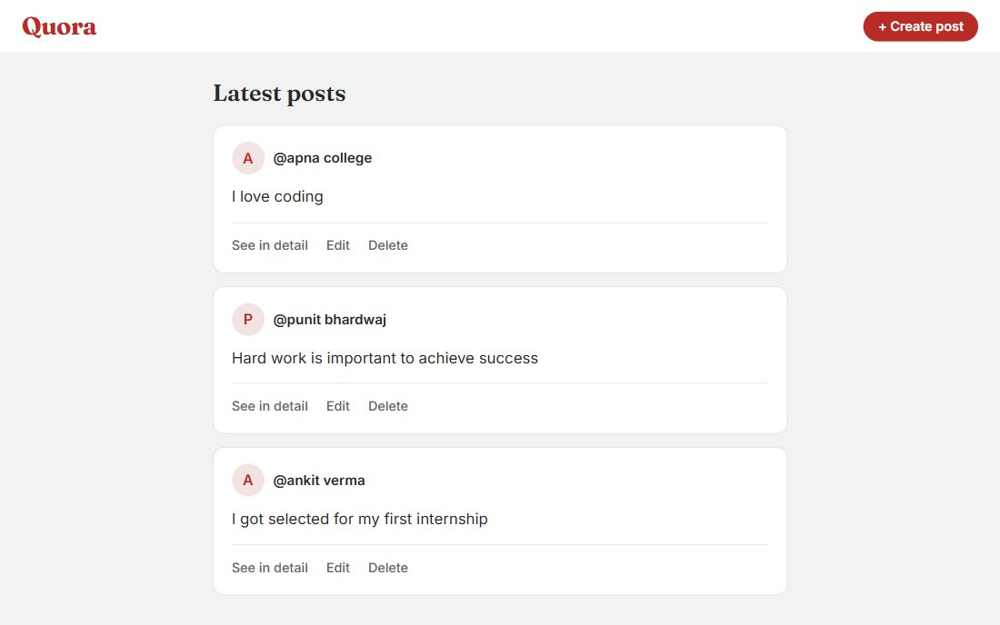

# Quora Posts

A posts board where you can write, read, edit and delete posts, all through RESTful routes.



## Tech stack

Node.js · Express 5 · EJS · method-override · uuid

Posts live in memory, so there's no database to set up (and they reset when the server restarts).

## Run it locally

You need [Node.js](https://nodejs.org) 20 or newer.

```bash
npm install
node index.js
```

Then open http://localhost:8080/posts.

| Method | Route | What it does |
|---|---|---|
| GET | `/posts` | All posts |
| GET | `/posts/new` | Form for a new post |
| POST | `/posts` | Create a post |
| GET | `/posts/:id` | One post |
| GET | `/posts/:id/edit` | Edit form |
| PATCH | `/posts/:id` | Update a post |
| DELETE | `/posts/:id` | Delete a post |
